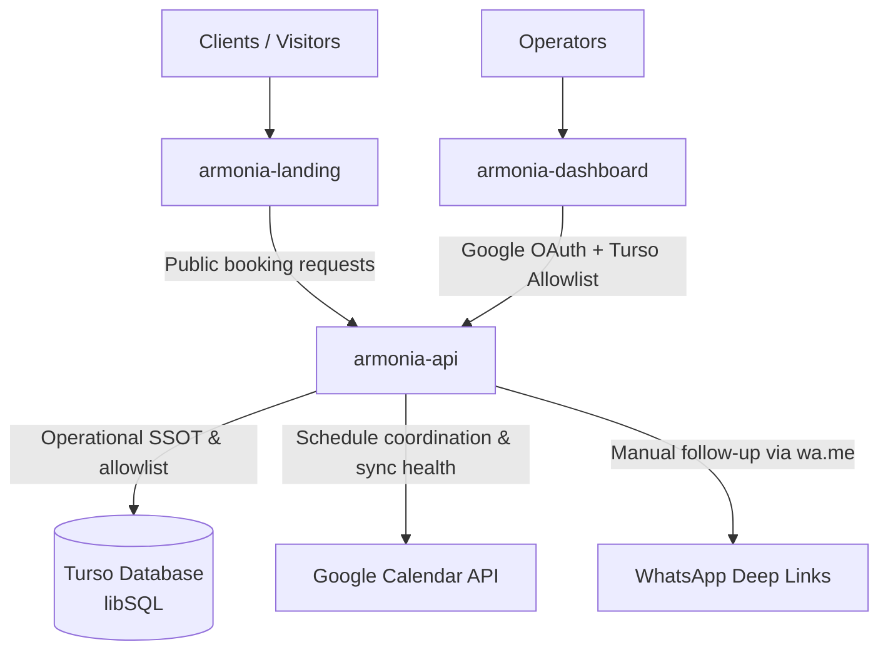

# ARMONÍA DEL SER

## Owner: 
Jasmin Isaza
## Ecosystem Architecture & Repositories

The project is structured into decoupled repositories with concrete roles:

| Repository              | Path                 | Role & Technology                                                                                                                                                                              | Target Platform                 | Stack                                                                                                                                                                                                                                                                                                                                                                                                                               |
| :---------------------- | :------------------- | :--------------------------------------------------------------------------------------------------------------------------------------------------------------------------------------------- | :------------------------------ | ----------------------------------------------------------------------------------------------------------------------------------------------------------------------------------------------------------------------------------------------------------------------------------------------------------------------------------------------------------------------------------------------------------------------------------- |
| **`armonia-api`**       | `armonia-api/`       | Core backend REST API, operational source of truth, separated booking/payment state engine, Google OAuth + Turso allowlist, and Google Calendar coordination.                                  | Google Cloud Run ($0 free tier) | [uv](https://docs.astral.sh/uv/), [Python 3.13](https://www.python.org/downloads/release/python-31316/), [FastAPI-standard](https://fastapi.tiangolo.com/), [SQLModel](https://sqlmodel.tiangolo.com/), [Turso libSQL](https://docs.turso.tech/libsql), [Google Calendar](https://developers.google.com/workspace/calendar/api/concepts), [ruff](https://docs.astral.sh/ruff/), [pyright](https://microsoft.github.io/pyright/#/), [pytest](https://docs.pytest.org/en/stable/) |
| **`armonia-dashboard`** | `armonia-dashboard/` | Administrative mobile-first operational control surface for operators to review, follow-up, and acknowledge payments, authorize delayed-payment exceptions, release slots, and track packages. | Cloudflare Pages ($0 free tier) | [Vite+](https://viteplus.dev/), [Tailwind](https://tailwindcss.com/), [HTMX](https://htmx.org/), [Biome](https://biomejs.dev/)                                                                                                                                                                                                                                                                                                      |
| **`armonia-landing`**   | `armonia-landing/`   | Public client-facing landing page, catalog showcase, and self-service reservation portal.                                                                                                      | Cloudflare Pages ($0 free tier) | [Vite+](https://viteplus.dev/), [Tailwind](https://tailwindcss.com/), [HTMX](https://htmx.org/), [Biome](https://biomejs.dev/)                                                                                                                                                                                                                                                                                                      |

> 🗺️ **Engineering Trajectory & Active Tasks:** See [`ROADMAP.md`](./ROADMAP.md) and [`todo.txt`](./todo.txt).

All repositories are hosted in [`armonia-del-ser`](https://gitea.roadtotech.me/armonia-del-ser):
## Canonical Business Description

En Armonía del Ser, somos un hogar de sanación y equilibrio. Nace de mi camino profesional y personal en 2007, combinando mis conocimientos en enfermería, psicología, temazcales, constelaciones, flores de Bach y herbolaria entre otros. 

Hoy, ofrecemos un espacio integral donde cuerpo, mente y espíritu se encuentran. Aquí guiamos meditaciones, retiros, círculos de cacao, trabajamos con cuencos de cuarzo, equilibrio de chakras y limpieza energética. También ofrecemos atención psicológica, desintoxicaciones, rituales personalizados y celebraciones sagradas. Te invitamos a conectar con tu esencia y descubrir tu propia armonía.

Somos un centro de atención  Psicológicas, terapias alternativas y de la salud, integrativo 
que te ayudan a encontrarte con tu verdadero Ser, a estar en equilibrio con tu entorno y descubrir el Amor, la alegría, la salud y la abundancia, que son tu verdadera razón de Ser.

## Operational Context

- **Business Name**: Armonía del Ser - Centro Holístico (founded in 2007 by Jasmin).
- **Location**: Vicente Guerrero, Felipe Ángeles, 43640 Tulancingo, Hgo., Mexico.
- **Contact / WhatsApp**: `+52 775 148 7912`
- **Core Offerings**:
  - *Group Sessions (Presencial & Online)*: Círculo de Cacao (Lunes 6 PM Presencial / Martes 7 PM Online), Meditación con cuencos (Martes 7 AM / Sábados 8 AM), Meditación con ejercicios conscientes (Martes 8 AM), Constelaciones Familiares (Jueves 7 PM Online), Clase de los 4 Elementos y Tarot (Viernes 9 AM Online), Meditación guiada (Sábados 7 AM), plus low-cost community workshops (e.g., *Curso de Abundancia y Prosperidad*, \$50 MXN/session).
  - *1-on-1 Consultations*: Atención Psicológica Individual (con cita previa, presencial u online), Flores de Bach, herbolaria, limpieza energética.
- **Primary Discovery Source**: [`armonia-del-ser/armonia-api#1`](https://gitea.roadtotech.me/armonia-del-ser/armonia-api/issues/1) (*Discovery Interview: Jasmin & Assistant Operational Feedback*).
- **Operational Realities**:
  - **20-Year Local Word-of-Mouth**: Most clients arrive via WhatsApp direct messages, phone calls, or in-person conversations.
  - **Collaborative Administration**: Both Jasmin and her remote assistant register participants, follow up on pending payments 48h prior, acknowledge payments, and update session counters.
