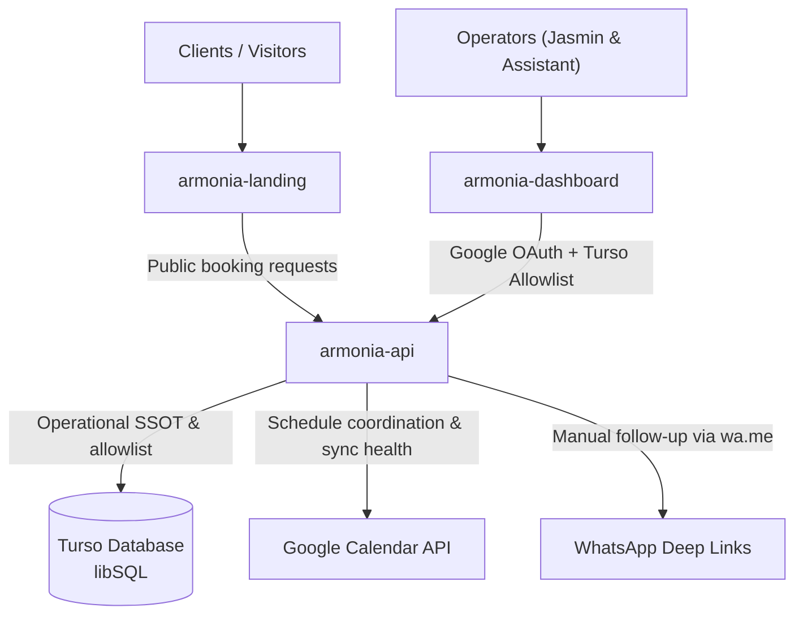

# Armonía del Ser

> Digital operations platform and administrative control surface for **Armonía del Ser**, an integrative psychology and holistic health center founded by **Jasmin Isaza** in Tulancingo, Hidalgo, Mexico (operating since 2007).

---

## 🏛️ Ecosystem Topology & Repositories

The platform is structured into decoupled repositories with clear separation of concerns, mirrored from our primary self-hosted forge:

| Repository | Role & Technology | Target Platform | Stack |
| :--- | :--- | :--- | :--- |
| [**`armonia-landing`**](https://github.com/armonia-del-ser/armonia-landing) | Public client-facing landing page, catalog showcase, and self-service reservation portal. | Cloudflare Pages ($0 free tier) | [Vite+](https://viteplus.dev/), [Tailwind CSS](https://tailwindcss.com/), [TypeScript](https://www.typescriptlang.org/), [Biome](https://biomejs.dev/) |
| [**`armonia-dashboard`**](https://github.com/armonia-del-ser/armonia-dashboard) | Administrative mobile-first control surface for operators to review, follow-up, and acknowledge payments, authorize delayed-payment exceptions, release slots, and track packages. | Cloudflare Pages ($0 free tier) | [Vite+](https://viteplus.dev/), [Tailwind CSS](https://tailwindcss.com/), [TypeScript](https://www.typescriptlang.org/), [Biome](https://biomejs.dev/) |
| [**`armonia-api`**](https://github.com/armonia-del-ser/armonia-api) | Core backend REST API, operational source of truth, separated booking/payment state engine, Google OAuth + Turso allowlist, and Google Calendar coordination. | Google Cloud Run ($0 free tier) | [uv](https://docs.astral.sh/uv/), [Python 3.13](https://www.python.org/downloads/release/python-31316/), [FastAPI](https://fastapi.tiangolo.com/), [SQLModel](https://sqlmodel.tiangolo.com/), [Turso libSQL](https://docs.turso.tech/libsql), [Google Calendar](https://developers.google.com/workspace/calendar/api/concepts) |
| [**`homelab-armonia`**](https://github.com/armonia-del-ser/homelab-armonia) | Containerized Homelab orchestration uniting API and Dashboard behind Traefik, Authelia ForwardAuth, and local SQLite/Turso persistence. | Homelab Server | Docker Compose, Traefik, Authelia, LLDAP |

---

## 📌 Operational Discovery & Ground Truth

> [!IMPORTANT]
> **Single Source of Truth (SSOT):** Do not assume business rules, payment flows, or scheduling constraints. Consult the primary operational discovery interviews:
>
> 1. **[Requirements Discovery Interview (2026-10-18)](https://github.com/armonia-del-ser/.github/blob/main/docs/interviews/2026-10-18-requirements-discovery.md):**  
>    Foundational discovery with Jasmin's assistant documenting 20 years of practice history, package accounting, WhatsApp-based intake funnels, and the critical need for mandatory buffer times between sessions.
> 2. **[Homelab Live PoC Feedback (2026-10-20)](https://github.com/armonia-del-ser/.github/blob/main/docs/interviews/2026-10-20-platform-feedback.md)** ([Versión en Español](https://github.com/armonia-del-ser/.github/blob/main/docs/interviews/2026-10-20-platform-feedback.es.md)):  
>    Frontline operational review following hands-on testing of the live Homelab demo, defining 2-step payment reconciliation (`voucher_received` $\to$ `reconciled`), payment extension (*prórroga*) deadline tracking, clinical session dossiers, and 5 foundational Agile user stories.

---

## 🌿 Canonical Business Description

En Armonía del Ser, somos un hogar de sanación y equilibrio. Nace del camino profesional y personal de Jasmin en 2007, combinando conocimientos en enfermería, psicología, temazcales, constelaciones, flores de Bach y herbolaria entre otros. 

Hoy, ofrecemos un espacio integral donde cuerpo, mente y espíritu se encuentran. Aquí guiamos meditaciones, retiros, círculos de cacao, trabajamos con cuencos de cuarzo, equilibrio de chakras y limpieza energética. También ofrecemos atención psicológica, desintoxicaciones, rituales personalizados y celebraciones sagradas.

Somos un centro de atención psicológica, terapias alternativas y de la salud integrativa que ayuda a las personas a encontrarse con su verdadero Ser, a estar en equilibrio con su entorno y descubrir la salud y la abundancia que son su verdadera razón de Ser.

---

## 📍 Operational Profile

* **Founder & Principal Therapist:** Jasmin Isaza
* **Location:** Vicente Guerrero, Felipe Ángeles, 43640 Tulancingo, Hgo., Mexico
* **Direct Channel:** WhatsApp (`+52 775 148 7912`)
* **Core Offerings:**
  * *Group Sessions (Presencial & Online):* Círculo de Cacao (Lunes 6 PM Presencial / Martes 7 PM Online), Meditación con cuencos (Martes 7 AM / Sábados 8 AM), Meditación con ejercicios conscientes (Martes 8 AM), Constelaciones Familiares (Jueves 7 PM Online), Clase de los 4 Elementos y Tarot (Viernes 9 AM Online), Meditación guiada (Sábados 7 AM), plus low-cost community workshops (e.g., *Curso de Abundancia y Prosperidad*, $50 MXN/session).
  * *1-on-1 Consultations:* Atención Psicológica Individual (con cita previa, presencial u online), Flores de Bach, herbolaria, limpieza energética.
